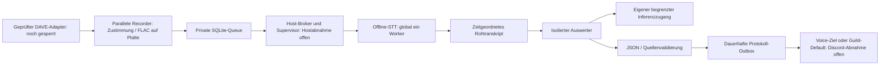

# Architektur und Datenvertrag

Ein gemeinsamer Steuerungsbot mit Konfiguration je Guild und einem Pool
zusätzlicher Aufnahme-Bot-Identitäten für parallele Sprachkanäle. Die Betriebsmodi
heißen Meeting und DnD. `tenant` ist die numerische Guild-ID; mehrere Guilds
im selben Modus teilen keine Sitzungen, Queues, Ergebnisziele oder Budgets.
`GuildDirectory` speichert Konfiguration mit Revisionen und routet Aktionen nur
zum Store der aktuellen Guild. Session und Ergebnis halten den Modus zusätzlich
als unveränderliche Metadaten fest.

Ein gemeinsamer Recorder-/Bot-Prozess kennt seine eingerichteten Guilds. Diese
Trennung ist anwendungsseitig, keine Betriebssystem-Sandbox pro Guild. Recorder,
STT und Auswertung bleiben technisch getrennte Stages; einzelne Worker erhalten
nur ihren konkreten Guild-Auftrag. Keine mandantenübergreifende Suche.

## Aufnahme und Zeit

Der Transport übergibt genau 20 ms PCM16, 48 kHz, Stereo und eine gemeinsame
Sitzungszeit in Millisekunden. Ein Frame umfasst 3840 Bytes. RTP-Uhren werden
je Verbindung an dieselbe monotone Sitzungsuhr gebunden; Wrap-around und Rejoin
sind getestet. Die Erstankunft enthält Netzwerk-/Jitterunsicherheit. Der Adapter
muss Empfang, Entschlüsselung, SSRC-Zuordnung, Abmeldung und Watchdog liefern.

Der Recorder schreibt synchron auf Platte, maximal eine geöffnete Datei je
Teilnehmer und Sitzung. Die Transportintegration muss eine begrenzte Übergabe verwenden und
bei Überlast pausieren; eine unbeschränkte Paketqueue ist nicht zulässig.
Teilnehmerzahl und Segmentanzahl sind zusätzlich hart begrenzt.
Nach höchstens 15 s, bei Pause oder bei einer Zeitlücke wird segmentiert.
Stille/fehlende Pakete werden nicht zusammengezogen; Lücken sind markiert,
ihre Ursache bleibt ohne Transportnachweis unbekannt. Überlappende Sprecher
bleiben getrennt. Alte/doppelte Frames werden verworfen. Die erzeugten Fenster
überlappen pro Sprecher nicht; importierte überlappende Audiofenster werden
abgelehnt. Transkript-Deduplizierung betrifft identische stabile IDs, nicht
bloße Textgleichheit oder tatsächlich gleichzeitige Sprache.

FLAC bewahrt PCM16 verlustfrei; es ist kein neuronaler Codec. Ein konservatives
PCM-plus-Header-Kontingent begrenzt die Gesamtaufnahme, auch wenn FLAC weniger
Platz benötigt. Vor jedem Frame werden freie Reserve und Kontingent geprüft.
Dauerlimits benötigen im späteren Transport zusätzlich regelmäßige `tick`-Aufrufe,
auch bei Stille. Harte Datenträgerquoten bleiben Aufgabe der Infrastruktur.

`audio/<uuid>.part` und ein Journal kennzeichnen einen offenen Teil. Nach fsync
folgen `.flac` und ein SHA256-Manifest; bei Absturz werden offene Teile zur
Prüfung erhalten und nicht automatisch transkribiert. Jeder Neustart markiert
aktive Sitzungen als unterbrochen; niemals automatisch weiteraufnehmen.
Die Live-Integration muss `interrupt_recordings()` vor Befehlsannahme aufrufen.

## Persistenz und Jobs

SQLite-Schema `PRAGMA user_version=4`: `identity`, `sessions`, `jobs`, `budgets`,
`deliveries`, `job_results` und `protocol_outbox`. WAL und synchronous FULL; nur lokale Dateisysteme.
Version 0 wird initialisiert, konforme Altversionen transaktional migriert,
unbekannte Versionen werden abgelehnt. Vor produktiven Migrationen konsistentes
Backup anlegen; Details und Rückweg im [Broker-Vertrag](BROKER.md).

Sitzung: waiting_consent → recording ↔ paused → stopped; Prozessausfall führt
zu interrupted. Gelöschte Sitzungen werden während der Dateibereinigung gesperrt;
anschließend werden Metadaten und Queue-Einträge entfernt. Fehlerhafte Bereinigung
ist wiederholbar. Löschung entfernt keine früheren Backups/Discord-Ausgaben.

Job: pending → running → succeeded. Fehler/Lease-Ablauf führen mit Backoff zu
pending, nach drei Versuchen zu dead. Atomare Übernahme mit Zufallstoken und
Lease; veraltete Tokens können nicht abschließen. Enqueue ist pro Sitzung/Phase
idempotent. Fehlgeschlagene Jobs behalten Rohdaten. Ressourcenmangel verbraucht
keinen Versuch. Der Dispatcher hält eine gemeinsame Host-Dateisperre über die
gesamte STT-Laufzeit; alle Instanzen müssen denselben Operator-Lock verwenden.

## Getrennte Worker und Handoff

`stt.run_handoff` liest nur `/input/handoff.json` und zugehörige geprüfte FLACs,
schreibt `/output`, liest `/model` ausschließlich und hat weder Queue-DB noch
Credentials. Pro Chunk atomare Checkpoints; Neustart verwendet geprüfte vorhandene
Ergebnisse. Das Modell wird erst beim ersten fehlenden Chunk importiert/geladen.
Ein Worker verarbeitet Spuren nacheinander und beendet danach den Prozess.

`evaluator.run_handoff` liest einen Session-Snapshot plus SHA256-gebundenes
Transkript. Eigener `/state` enthält nur Auswertungszustand und Budget dieses
Mandanten; `/output` enthält das geprüfte Ergebnis. Kein Mount der Recorder-DB
oder der Audios. Nur der Gateway-Token wird benötigt, kein Discord-/Host-Key.

Der Broker-Kern kopiert ausschließlich erlaubte Jobdateien in versiegelte
Snapshots, hält Schreibbereiche getrennt und übernimmt Outputs nur mit gültiger
Job-/Versuchsbindung. Ergebnisbeleg, Jobabschluss und erlaubter Folgeauftrag
werden gemeinsam committet; Leser prüfen den Beleg und Datei-Hashes. Teilresultate
werden erst nach bestätigter Worker-Beendigung validiert und für einen neuen
Versuch vorbereitet. Ein Lease-Ablauf allein erlaubt keinen weiteren Start.

Die native Supervision und eine Ansible-Rolle für Units, Cgroup-Nachweise und
Host-Rechte liegen im Infrastrukturprojekt; tatsächliche Provisionierung und
Linux-Abnahme stehen aus. Die Demo
verwendet synchrone Fixtures. `worker_argv` bereitet nur den festen Aufruf vor
und startet nichts. Die Anwendung erhält keine Engine-API oder Host-Befehlsroute.
Siehe [Broker-Vertrag](BROKER.md).

## Auswertung und Zustellung

Ein Call je abgeschlossener Sitzung im Normalfall; Modell, Prompt v1,
Temperatur und Limits stammen aus dem unveränderlichen Session-Snapshot.
UTF-8-Bytes plus Overhead liefern eine konservative Eingabeobergrenze für
explizit geprüfte Byte-Fallback-Tokenizer. Modell-/Gateway-Limits müssen separat
bestätigt werden. Bei Überlauf erfolgt keine Kürzung. Aufteilungsmodus ist
noch nicht implementiert; Konfiguration erlaubt bewusst nur `reject`.

Kein Tool-Feld, keine Befehlsausführung, keine dynamischen Modell-/HTTP-Routen.
JSON-Schema, Mandant, Session, Quellen, explizite Zuständigkeits-/Fristbelege
und Charakterzuordnung werden lokal geprüft. Semantische Fehlinterpretationen
bleiben möglich. Mehrere Markdown-Ansichten benötigen keine zusätzlichen Calls.

Budget wird vor dem Request atomar reserviert und auch bei unklarer Antwort
verbraucht. Der lokale Grenzwert ist zusätzliche Absicherung; der getrennt
berechtigte Gateway muss den eigentlichen Anbieterzugang begrenzen.

Publikation hat durable sending/sent/uncertain-Zustände. Nach unklarer Quittung
wird nicht automatisch erneut gesendet; Operator-Abgleich verhindert Duplikate.
Der Publisher-Vertrag verwendet bis 1900 Zeichen Text, darüber begrenzte
Markdown-Anhänge (maximal 2 MB). `DiscordDelivery` setzt den Versandvertrag mit
Guild-/Kanal-/Rechteprüfung und ausgeschalteten Mentions um. Der Steuerungsclient pollt die Outbox im Hintergrund auf seinem Policy-Thread.
Ein echter Zustelltest in einer autorisierten Testguild steht aus.

## Guild-Konfiguration

Konfigurationsschema 2 ist getrennt von den Sitzungsspeichern. `/setup` und
`/config` erfordern verifizierte Manage-Guild-Berechtigung der handelnden Person.
Kanäle/Rollen müssen der aktuellen Guild gehören; Datenwurzeln kommen nie aus
Commands. Eine Guild-Sperre serialisiert Konfiguration und Steuerung. Aktive
Aufnahmen oder wartende/laufende Jobs verhindern Umkonfiguration. Steuerungs- und Aufnahme-Tokens
werden ausschließlich im jeweiligen Discord-Transport verwendet.

Der Steuerungsclient verwendet exakt Pycord 2.8.1, ohne dessen Voice-Empfänger
zu aktivieren. Alle Slash Commands entstehen aus denselben Definitionen wie
die Policy-Tests. Unterbefehle besitzen einen echten Parent und Discord-Typ 1.
Nach erfolgreicher Registrierung und Rückprüfung der globalen Commands wird
die Control-Bereitschaft gesetzt. Ein 30-Sekunden-Heartbeat enthält nur Revision,
Zeit und Control-/Voice-/Cloud-Bereitschaft; Voice/Cloud bleiben false.

Discord-I/O läuft im Async-Eventloop. Ein einzelner dedizierter Executor hält
SQLite und synchrone Policy auf demselben Thread. Höchstens 16 Interaktionen
dürfen gleichzeitig warten; weitere bekommen eine feste Beschäftigt-Antwort.
Client-Abbruch schließt die Verbindung und Datenbank. Aufnahme/Resume sowie
native Verarbeitung bleiben auch bei manipuliertem Config-Flag gesperrt.

Parallele Captures, globale Speicher-/Spurreservierungen, automatische Session-
Queue und Voice-spezifische Protokollziele sind im [Aufnahmevertrag](RECORDING.md)
beschrieben. Aufnahme und nachgelagerte Bearbeitung sind unabhängige Laufzeitrollen.
